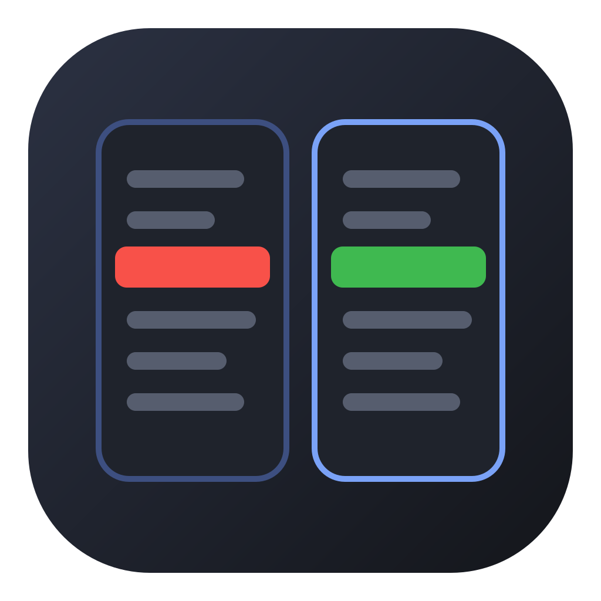

<div align="center">



# SideBySide

### by 92-bit

**See exactly what changed between two text files — instantly, even when they're huge.**

Fast · Lightweight · Free forever · Open source

[](LICENSE)
[](#-download)
[](https://github.com/92-bit/SideBySide/releases/latest)

</div>

---

## ✨ Why SideBySide?

Most comparison tools are either **heavy** or **struggle with large files**. SideBySide is built to do one job really well: put two files next to each other and show you every difference — clearly, quickly, and without slowing down your computer.

| | |
|---|---|
| ⚡ **Fast with huge files** | Compares files of hundreds of megabytes without freezing. |
| 🪶 **Light on your computer** | About 5 MB to download, and very little memory in use. |
| 🎒 **Portable** | One file. Run it from a folder or a USB stick — no install needed. |
| 📥 **Install if you like** | Prefer a normal app? Click **Install** inside SideBySide. No admin rights required. |
| 🔄 **Updates itself** | New versions arrive automatically, signed so you know they're genuine. |
| 🌗 **Light & dark** | The *Midnight* look by night, a clean light look by day — one click to switch. |
| 🔒 **Private** | Your files never leave your computer. No accounts, no tracking. The only time it goes online is a once-a-day update check with GitHub, which you can switch off in **Help → About**. |

---

## 📦 Download

### [⬇ Download SideBySide for Windows](https://github.com/92-bit/SideBySide/releases/latest/download/SideBySide.exe)

Linux: get the `.AppImage` or `.deb` from the [**latest release**](https://github.com/92-bit/SideBySide/releases/latest).

1. Download **`SideBySide.exe`** using the link above.
2. Double-click it. That's it — you're comparing.
3. *(Optional)* Click **Install** in the app to add it to your Start Menu and the right-click menu.
   To remove it later: **Settings → Apps → SideBySide → Uninstall**.

> 💡 **Seeing "Windows protected your PC"?** That's normal for new free apps.
> Click **More info → Run anyway**.

---

## 🗺️ Roadmap

### Version 1 — the essentials
- [x] Compare two files, from tiny to very large
- [x] Highlight the exact words that changed inside a line
- [x] Drag and drop files onto the window
- [x] Jump to the next / previous difference (<kbd>F7</kbd> / <kbd>F8</kbd>)
- [x] Ignore spaces, blank lines, or upper/lower case
- [x] Light and dark mode
- [x] Recent comparisons
- [x] Find (<kbd>Ctrl</kbd>+<kbd>F</kbd>) and *Go to line* (<kbd>Ctrl</kbd>+<kbd>G</kbd>)
- [x] Paste two pieces of text and compare them — no files needed
- [x] Progress bar with **Cancel** for big files
- [x] Zoom text in and out (<kbd>Ctrl</kbd> + mouse wheel)
- [x] Portable file with a built-in **Install** button (no admin rights needed)
- [x] Right-click **Compare with SideBySide** in File Explorer
- [x] Automatic updates, signed so they can't be faked

### Coming next
- Copy changes from one side to the other and save (merge)
- Export differences as a report
- Live reload when a file changes (great for log files)
- Colors for code files
- Command-line mode
- More languages
- Tabs for several comparisons at once

### Later on
- Compare whole folders
- Three-way compare
- Detect lines that only moved
- Custom ignore rules (for example, skip timestamps in logs)
- Save and reopen comparison sessions

---

## 🧠 How it handles huge files

Think of reading a very long book:

1. **One page at a time** — SideBySide reads files in small pieces, never all at once.
2. **A fingerprint for every line** — each line becomes a short code. Comparing codes is far faster than comparing whole lines.
3. **Only draw what you see** — the screen shows about 50 lines. The millions of others wait until you scroll to them.

**Measured:** two 500 MB files (5.1 million lines each) are compared in about **1.3 seconds**,
using at most **~85 MB** of memory while comparing. Scrolling anywhere in the file is instant.

---

## 🛠️ For developers

SideBySide is built with [Tauri 2](https://tauri.app) (Rust) and [Svelte 5](https://svelte.dev).

**You'll need:** [Node.js](https://nodejs.org) 20+, [Rust](https://rustup.rs), and on Windows the
[Visual Studio C++ Build Tools](https://visualstudio.microsoft.com/visual-cpp-build-tools/).

```bash
git clone https://github.com/92-bit/SideBySide.git
cd SideBySide
npm install
npm run tauri dev        # run the app while developing
npm run tauri build      # build the finished app
```

---

## 🤝 Contributing

Ideas, bug reports and translations are very welcome!
Open an [issue](https://github.com/92-bit/SideBySide/issues) to say hello.

---

## 📜 License

SideBySide is free software under the [GNU General Public License v3.0](LICENSE).
You can use, share and change it — and any shared copies must stay free and open too.

<div align="center">
<br>
<sub>Made with care by <b>92-bit</b></sub>
</div>
